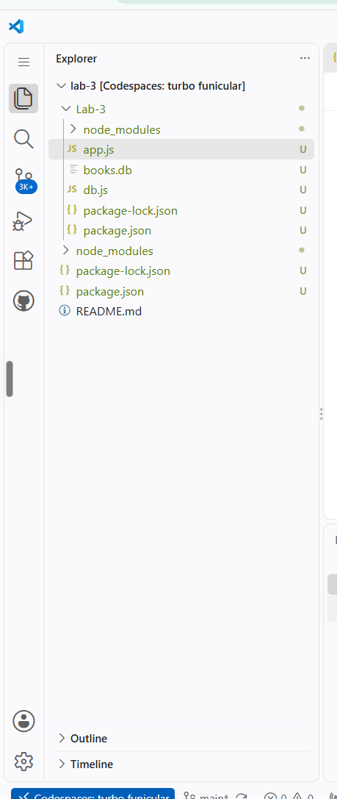
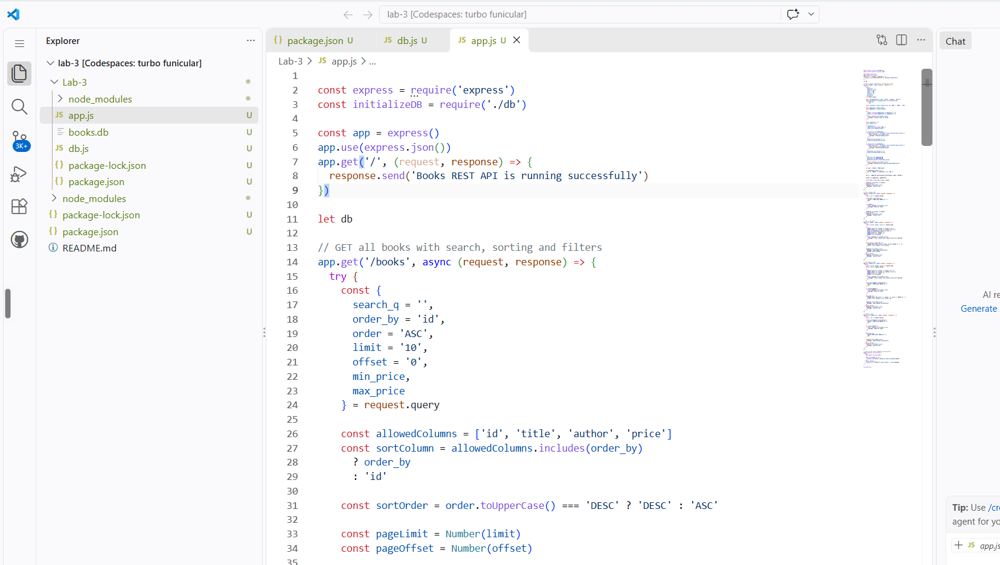
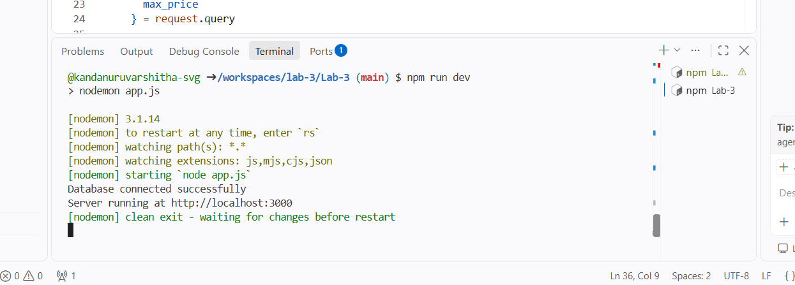
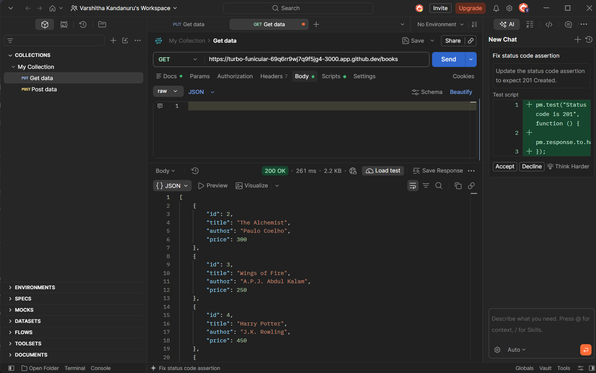
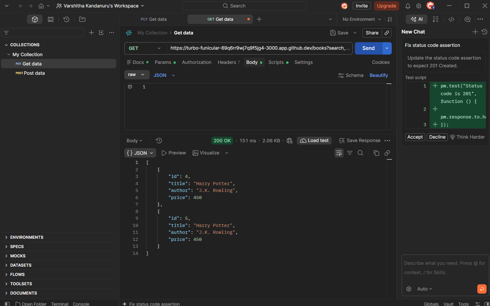
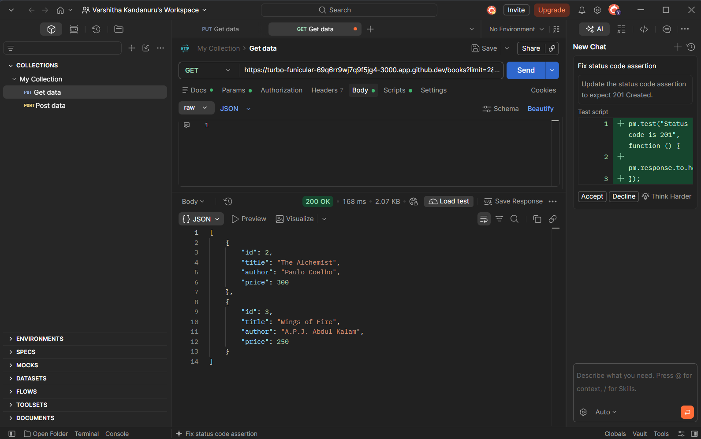
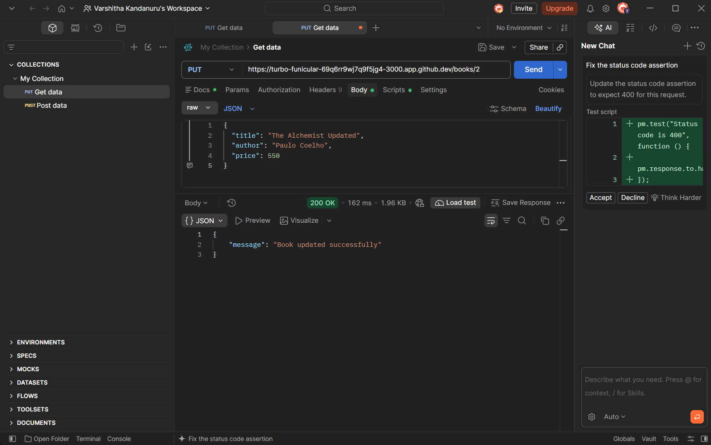
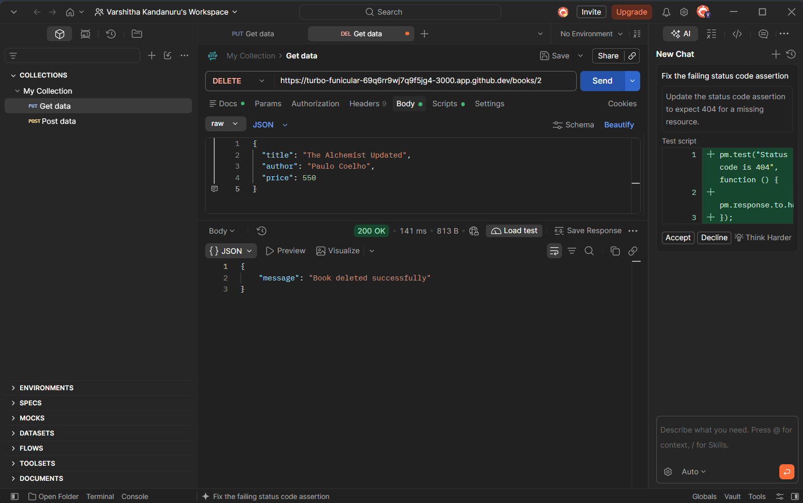
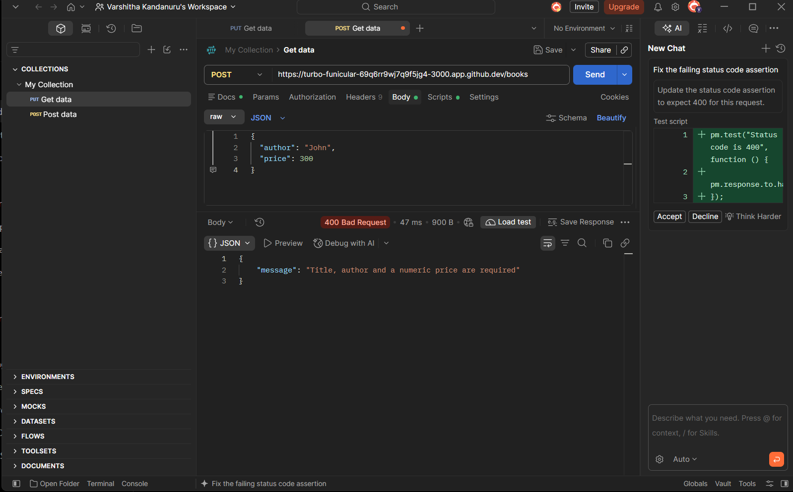
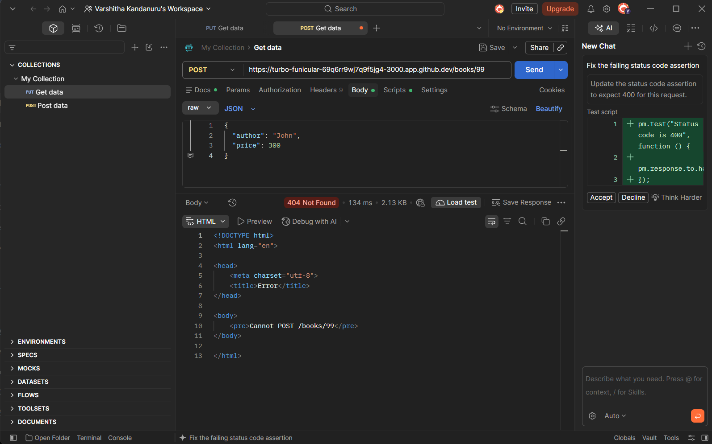

# Lab 3: REST API, Query Parameters, Validation and Debugging

## Course Details
- **Course:** Backend Development Fundamentals
- **Year:** II
- **Term:** II
- **Lab:** 3
- **Module:** RESTful API Development and Validation
- **Faculty:** Joel Prashanth D

## Objective
To develop a REST API using Node.js, Express.js and SQLite with search, sorting, filtering, input validation, correct HTTP status codes and debugging.

## Technologies Used
- Node.js
- Express.js
- SQLite
- JavaScript
- Postman
- GitHub Codespaces

## Project Structure

```text
Lab-3/
├── Lab-3/
│   ├── app.js
│   ├── db.js
│   ├── books.db
│   ├── package.json
│   └── package-lock.json
├── screenshots/
└── README.md
```

## API Endpoints

| Method | Endpoint | Description |
|---|---|---|
| GET | /books | Get all books |
| GET | /books/:id | Get a book by ID |
| POST | /books | Add a new book |
| PUT | /books/:id | Update a book |
| DELETE | /books/:id | Delete a book |

## Query Parameters

- `search_q` – Search books by title.
- `order_by` – Sort by ID, title, author or price.
- `order` – ASC or DESC.
- `limit` – Number of records to display.
- `offset` – Number of records to skip.
- `min_price` – Minimum book price.
- `max_price` – Maximum book price.

### Example Requests

```text
GET /books?search_q=Harry
GET /books?order_by=price&order=DESC
GET /books?min_price=250&max_price=400
GET /books?limit=2&offset=0
```

## Input Validation

The API validates the following:
- Book title is required.
- Author is required.
- Price must be numeric.
- Invalid input returns HTTP 400.

## HTTP Status Codes

| Status Code | Meaning |
|---|---|
| 200 | OK |
| 201 | Created |
| 400 | Bad Request |
| 404 | Not Found |
| 500 | Internal Server Error |

## Installation and Execution

1. Clone or download the project.
2. Open the terminal.
3. Navigate to the project folder:

```bash
cd Lab-3
```

4. Install dependencies:

```bash
npm install
```

5. Start the server:

```bash
npm run dev
```

The server runs on port 3000.

## Testing

All API endpoints are tested using Postman.

Testing includes:
- Adding books.
- Retrieving books.
- Searching books.
- Sorting books.
- Filtering by price.
- Pagination using limit and offset.
- Updating books.
- Deleting books.
- Testing invalid input.
- Testing missing records.

## Debugging Exercises

The following errors were studied and fixed:
1. Port conflict (EADDRINUSE).
2. Incorrect import path.
3. Incorrect SQLite table name.
4. Missing await in asynchronous database operations.

## Security and Best Practices

- Used parameterized SQL queries.
- Validated user input.
- Used appropriate HTTP status codes.
- Avoided committing `.env` files.
- Excluded `node_modules` from submission.

## Screenshots

### 1. Project Structure


### 2. App.js Code


### 3. Server Running


### 4. POST - Add Book


### 5. GET - All Books


### 6. Search Books


### 7. Sort Books


### 8. Price Filtering


### 9. Pagination


### 10. PUT - Update Book


### 11. DELETE - Delete Book


### 12. Validation - 400


### 13. Not Found - 404



## Conclusion

Successfully developed a RESTful API using Node.js, Express.js and SQLite. Implemented CRUD operations, query parameters, search, sorting, price filtering, input validation and debugging. Tested the API using Postman.
## Deployment link
https://backend-lab-3-1-v4sx.onrender.com/
